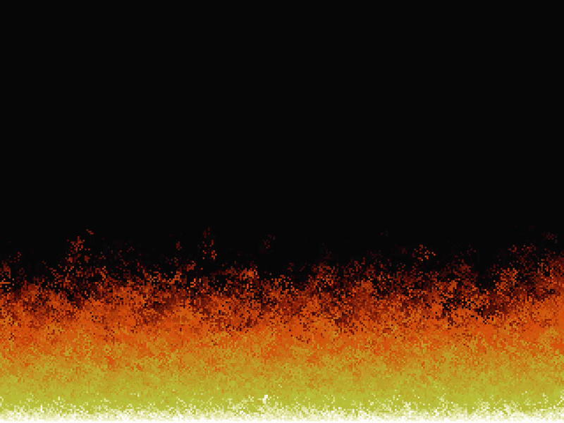

# Doom-Style Fire Effect in C

A real-time **Doom-style fire effect** implemented from scratch in **C using SDL3**.

This project was built to explore **low-level graphics programming**, framebuffer manipulation, pixel rendering, procedural animation, and basic software-rendering concepts without relying on a high-level game engine.

## Demo

<p align="center">
  
</p>

<p align="center">
  Real-time procedural fire rendered directly into a software framebuffer and displayed through an SDL3 texture.
</p>

---

## Features

- Classic Doom-inspired fire effect
- 37-color fire palette
- Custom software framebuffer
- Direct pixel manipulation
- Randomized fire propagation
- Intensity decay
- Real-time animation at approximately 60 FPS
- Nearest-neighbor texture scaling
- Manual SDL resource cleanup
- Written in C with SDL3

---

## Technologies

- **C**
- **SDL3**
- **GCC**
- **MSYS2 / UCRT64**
- **pkg-config**

---

## How It Works

The fire is represented as a 2D array of intensity values:
```
static uint8_t fire_pixels[FIRE_W * FIRE_H];
```

Each value represents the intensity of a pixel in the fire.

The bottom row is initialized with maximum intensity:
```
fire_pixels[(FIRE_H - 1) * FIRE_W + i] =
    FIRE_PALETTE_SIZE - 1;
```

Each frame, the intensity of every pixel is propagated upward with a small randomized horizontal displacement and intensity decay.

The intensity value is then used as an index into the fire palette:
```
uint8_t idx = fire_pixels[y * FIRE_W + x];

put_pixel(x, y, fire_palette[idx]);
```

The resulting framebuffer is uploaded to an SDL3 texture:
```
SDL_UpdateTexture(
    texture,
    NULL,
    framebuffer,
    WIDTH * sizeof(uint32_t)
);
```

SDL3 then handles displaying the texture in the window.

---

## Rendering Pipeline

The project follows a simple software-rendering pipeline:
```
Fire Simulation
      ↓
Fire Intensity Array
      ↓
Color Palette
      ↓
Software Framebuffer
      ↓
SDL3 Texture
      ↓
SDL3 Renderer
      ↓
Screen
```

The framebuffer itself is simply a contiguous array of pixels:
```
static uint32_t framebuffer[WIDTH * HEIGHT];
```

A pixel is accessed using:
```
index = y × WIDTH + x
```

---

## Resolution

The internal framebuffer uses:
```
320 × 240
```

The resulting image is scaled up using nearest-neighbor scaling to preserve the pixel-art appearance.

---

## Building and Running

### Prerequisites

Make sure you have:

- Windows 10/11
- GCC (MinGW-w64 / UCRT64)
- MSYS2
- pkg-config
- SDL3

### Compile

Using MSYS2 UCRT64:
```
gcc main.c `pkg-config --cflags sdl3` `pkg-config --libs sdl3` -o framebuffer
```

### Run
```
./framebuffer.exe
```

---

## Project Structure
```
c-sdl3-doom-fire/
│
├── main.c
├── README.md
└── .gitignore
```

---

## What I Learned

This project was created as an introduction to **low-level graphics programming in C**.

Through this project I explored:

- Framebuffers
- Pixel addressing
- 2D → 1D array mapping
- Texture updates
- SDL3 rendering
- Procedural animation
- Randomized simulations
- Color palettes
- Frame timing
- Basic software-rendering concepts
- Manual memory/resource management

One of the key concepts is representing a 2D image as a 1D block of memory:

---

## Possible Future Improvements

Some ideas for future versions:

- Interactive fire intensity
- Multiple fire sources
- Wind simulation
- Different fire palettes
- Fire extinguishing effect
- Adjustable resolution
- Color palette switching
- Optimized fire simulation
- Wolfenstein-3D-style renderer.
- Port the renderer to OpenGL

---

## Inspiration

Inspired by the classic **Doom fire effect**, the broader concept of learning low level graphics programming by building rendering systems from the ground up, and the **freeCodeCamp.org YouTube tutorial by Gustavo Pezzi**.

---

If you found this project interesting, feel free to explore the code and experiment with the fire simulation.